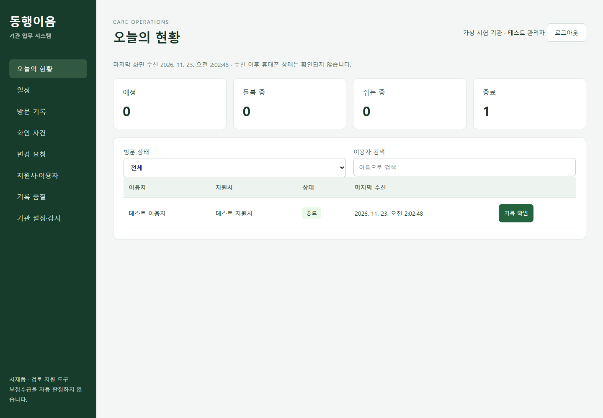
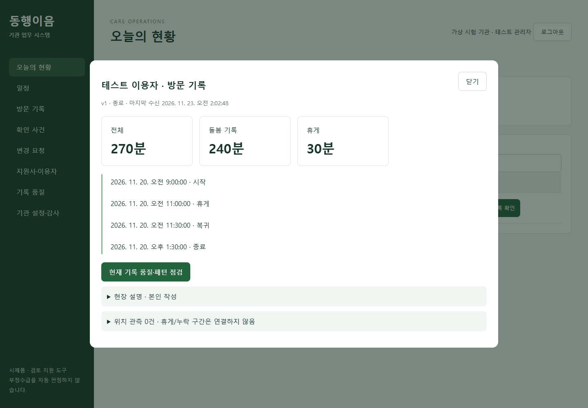

# 동행이음 · Dolbom Ieum

**활동지원사는 간편하게 기록하고, 기관은 확인이 필요한 방문과 그 이유를 살펴봅니다.**

동행이음은 장애인활동지원 서비스의 방문 시간·위치 기록과 현장 설명을 연결하는 **전자바우처 보완 시제품**입니다. 활동지원사 앱과 기관 관리자 웹을 통해 방문 기록을 관리하고, 규칙 및 AI 분석으로 확인이 필요한 징후를 제시합니다.

청주대학교 인공지능소프트웨어학과 창업 캡스톤 프로젝트입니다.

> **현재 단계: 시제품 구현 및 검증**
> 앱 20개·관리자 웹 11개 Figma 기반 정적 화면과 별도의 백엔드 연동 코드를 포함합니다. 새 정적 화면의 실제 API 연결은 진행 전입니다. AI는 검토 후보를 제공하며, 위치만으로 동행·실제 돌봄·부정수급을 확정하지 않습니다.

## 프로젝트를 시작한 이유

서비스 시작·종료 결제 기록만으로는 실제 지원 상황을 충분히 설명하기 어렵습니다. 통신 장애나 종료 입력 누락처럼 정상적인 방문에도 확인과 설명이 필요한 경우가 있습니다.

활동지원기관 사무국장 인터뷰에서 실제 서비스 없는 결제, 카드 대리 소지, 복잡한 앱 조작과 기관의 소명자료 확인 부담을 문제로 파악했습니다. 이는 한 명의 인터뷰를 바탕으로 한 문제 가설이며, 발생 빈도나 피해 규모를 입증하는 통계는 아닙니다.

초기 생체인증 아이디어에서 방향을 바꾸어 **이용자의 추가 인증 부담을 줄이고, 활동지원사의 기록과 관리자의 확인 업무를 돕는 방식**을 개발하고 있습니다.

## 누가 사용하나요?

| 사용자 | 주요 역할 |
| --- | --- |
| 활동지원사 | 배정 일정 확인, 시작·휴게·복귀·종료 기록, 현장 사유와 답변 제출 |
| 기관 관리자 | 일정·이용자·지원사 관리, 확인 후보 검토, 설명 요청, 정정 승인·반려 |
| 장애인 이용자 | 돌봄 서비스 대상. 별도 앱 설치·생체인증·QR 인증을 요구하지 않는 방향 |

여러 기관을 지원하며, 활동지원사는 동시에 한 기관에 소속되는 구조입니다.

## 핵심 기능

### 활동지원사 앱

- **방문 기록:** 시작 → 휴게 → 복귀 → 종료. 실제 휴게 시간을 돌봄 기록 시간과 구분합니다.
- **오프라인 대응:** 시간·이벤트·수집된 위치를 휴대폰 SQLite에 저장하고 연결 복구 후 재전송합니다.
- **위치 수집 제어:** 동의와 권한을 확인하며, 휴게·종료 시 수집을 중단합니다. 위치를 확보하지 못해도 시간 기록을 유지합니다.
- **현장 설명:** 선택적 사유 기록, 기관 질문에 대한 답변, 일정 변경 및 기록 정정 요청을 제공합니다.
- **접근성 고려:** 큰 글씨와 버튼, 단순한 조작 흐름, 색뿐 아니라 문자로 구분하는 상태 표시를 사용합니다.

### 관리자 웹

- **오늘의 현황:** 방문 상태와 검토 상태를 나누어 확인합니다.
- **일정·방문 관리:** 일정 배정, 방문 검색·필터, 임시 방문 기록을 확인합니다.
- **검토 업무:** 확인 이유 → 시간 구간 → 현장 설명 → 필요한 경로 순서로 살펴봅니다.
- **설명 요청과 결과 저장:** 지원사 답변과 기관 답변을 연결하고, 추가 확인이 필요하면 검토를 보류합니다.
- **정정 비교:** 원본과 제안 값을 비교해 승인·반려하며 원본 기록을 보존합니다.

### 분석 및 데이터 보호

- GPS 정확도 부족·수집 공백·수신 지연을 부정 의심과 구분합니다.
- 시간 중복, 종료 미수신, 장시간 외부 관측, 유사 위치 체류 등 설명 가능한 시험 규칙을 적용합니다.
- 과거 자료가 조건을 만족하면 `IsolationForest`로 기록 시간 패턴 차이를 검토 후보로 제시합니다.
- Supabase RLS와 DB RPC에서 기관 범위 및 역할을 확인합니다.
- 관리자에게만 초기 후보를 노출하고, 관리자가 설명을 요청한 뒤 지원사가 답변하는 흐름을 사용합니다.

**기존 전자바우처 결제·급여 산정·환수 처리를 대체하거나 정부 시스템과 연결한 서비스는 아닙니다.**

## 서비스 흐름

1. 운영자가 기관과 최초 관리자를 등록합니다.
2. 활동지원사가 가입하고 기관 연결을 수락합니다.
3. 관리자가 이용자와 일정을 배정합니다.
4. 활동지원사는 시작·휴게·복귀·종료를 기록합니다.
5. 시스템이 수신 기록의 품질과 확인 후보를 분석합니다.
6. 관리자가 근거를 확인하고 필요한 경우 설명을 요청합니다.
7. 지원사 답변과 정정 내역을 확인한 뒤 기관이 검토 결과를 저장합니다.

## 화면 미리보기

아래 이미지는 **기존 백엔드 연동용 관리자 웹을 가상 데이터로 시험한 화면**입니다. 새 Figma 정적 데모와는 별도 화면입니다.

| 현황 | 방문 상세 |
| --- | --- |
|  |  |

새 Figma 기반 화면은 아래 정적 데모로 직접 확인할 수 있습니다.

## 기술 구성

| 영역 | 기술 |
| --- | --- |
| 활동지원사 앱 | Flutter · Dart |
| 관리자 정적 데모 | HTML · CSS · JavaScript |
| 기존 연동 관리자 웹 | Jinja2 · JavaScript |
| API | Python 3.13 · FastAPI · Uvicorn |
| 서버 DB·인증 | Supabase PostgreSQL · Auth · RLS · RPC |
| 앱 로컬 저장·위치 | SQLite · Geolocator |
| 분석 | 규칙 기반 점검 · scikit-learn IsolationForest |
| 검증 | pytest · Flutter Test · Playwright · PGlite |

## 빠르게 실행하기

저장소를 내려받고 프로젝트 루트에서 시작합니다. 아래 명령은 PowerShell 기준입니다.

```powershell
git clone https://github.com/TAEHEE-MUN/Dolbom_ieum.git
cd Dolbom_ieum
```

### 1. 관리자 웹 정적 데모

Python이 설치되어 있으면 별도 DB나 계정 없이 실행할 수 있습니다.

```powershell
python -m http.server 5175 --bind 127.0.0.1 --directory apps/admin-demo
```

[http://127.0.0.1:5175](http://127.0.0.1:5175)에서 로그인 버튼을 누르면 시연 화면으로 이동합니다. 입력과 승인 동작은 메모리에서만 처리하며 새로고침하면 초기화됩니다.

### 2. 활동지원사 앱 정적 데모

Flutter와 Chrome이 필요합니다. 개발 검증에는 Flutter 3.47.0을 사용했습니다.

```powershell
cd apps/mobile
flutter pub get
flutter run -d chrome -t lib/main_demo.dart --web-port 5174
```

정적 데모는 실제 로그인·GPS 수집·백엔드 연결을 수행하지 않습니다.

### 3. 백엔드와 기존 연동 화면

프로젝트 루트에서 Python 3.13과 `uv`를 사용합니다.

```powershell
uv sync --locked
Copy-Item .env.example .env
# .env에 본인의 Supabase URL과 publishable key를 설정합니다.
uv run uvicorn backend.main:app --host 127.0.0.1 --port 8000
```

- 관리자 웹: [http://127.0.0.1:8000](http://127.0.0.1:8000)
- API 문서: [http://127.0.0.1:8000/docs](http://127.0.0.1:8000/docs)
- 관리자: 이메일·비밀번호 로그인 후 기관 관리자 소속을 확인합니다.
- 활동지원사 앱: 문자 인증을 사용합니다. 실제 발송에는 Supabase의 SMS 설정이 필요합니다.
- 기기용 앱의 진입점은 `apps/mobile/lib/main.dart`이며 `config/development.example.json`을 참고합니다.

`.env`가 이미 있다면 덮어쓰지 마세요. 서버 실행만으로 DB나 관리자 계정이 자동 생성되지는 않습니다.

### DB 준비

- **빈 DB 최초 구축:** `db/setup_all.sql`을 검토 후 한 번 적용합니다.
- **기존 초기 스키마 업그레이드:** `db/frontend_alignment.sql`에 프론트 정합성 보완 변경이 있습니다.
- **최초 관리자:** Supabase Auth에 이메일 계정을 준비하고 운영자 전용 `private.provision_agency_email`로 기관에 연결합니다.
- 기존 DB에 최초 구축 SQL을 다시 실행하지 마세요. 실제 인증 정보는 저장소에 올리지 않습니다.

## 저장소 구조

```text
apps/
  mobile/                # Flutter 앱: 정적 데모 및 기존 연동 코드
  admin-demo/            # Figma 기반 관리자 웹 정적 데모
backend/                 # API, 화면별 응답, 입력 검증, 기존 관리자 웹
ai/                      # 품질 점검·규칙·과거 패턴 후보 분석
db/                      # 초기 스키마·권한·운영자 등록·업그레이드 SQL
tests/                   # API·DB·브라우저 검증
docs/                    # 기획, 화면 검토, 실행 안내, API 명세
```

## 구현 및 검증 현황

**2026-11-23 기준**이며, 로컬 테스트 통과와 실제 운영 검증을 구분합니다.

| 항목 | 상태 |
| --- | --- |
| Figma 정적 화면 | 앱 20개 · 관리자 웹 11개 구현 및 흐름 검사 |
| Python 테스트 | 27개 통과 |
| Flutter 검사 | 정적 분석 이상 없음 · 테스트 6개 통과 |
| 브라우저 검사 | 화면 이동·검색·필터·검토·정정·작은 화면·스크롤 통과 |
| 로컬 DB 검사 | 15개 테이블 RLS, 기관 격리, 역할, 원본 보존, 재전송·승인 검사 통과 |
| 빌드 | 정적 앱 Web · 기존 기기용 앱 Android debug 빌드 성공 |
| 원격 DB | 초기 구축 기록 있음. 최신 보완 SQL은 인증 연결 오류로 원격 반영 대기 |
| 실제 통합 시험 | 새 정적 UI의 API 연결, SMS 발송, 실제 사용자 DB 왕복 미완료 |
| 실기기·AI 성능 | 백그라운드 GPS·배터리·iOS 실행·AI 정확도와 오탐률 미검증 |

테스트 재실행 예시:

```powershell
# 프로젝트 루트
uv run pytest -q
npm ci --prefix tests/db
node tests/db/check.mjs
node tests/db/check_setup.mjs

# Chrome 설치 및 관리자 정적 서버(5175) 실행 후
npm ci --prefix tests/web
node tests/web/admin-demo.mjs

# Flutter 앱
cd apps/mobile
flutter analyze
flutter test
```

## 앞으로의 개발

- 새 정적 UI를 실제 API·앱 오프라인 저장 로직과 연결
- 원격 DB 변경 적용 및 실제 인증·기관별 권한 재검증
- 관리자별 세부 승인 권한, 보관·삭제 정책 구체화
- 서버 상시 분석·알림 처리 및 수신 지연 측정
- 휴대폰 움직임 센서 시험과 실물 기기의 배터리·백그라운드 검증
- 합성 데이터 시험 이후 동의받은 테스트 환경에서 AI 오탐·누락 평가

현재는 GPS 체류를 휴대폰 움직임 센서 측정으로 대체하지 않습니다. 기존 연동 웹의 2분 간격 분석 호출은 화면이 열려 있을 때만 동작하며, 서버 상시 분석이나 2~5분 알림 성능을 보장하지 않습니다.

## 자세한 문서

- [최신 기능 대응·검증 결과와 남은 항목](docs/프론트기준_기능정합성_검토결과.txt)
- [활동지원사 정적 앱 실행 안내](docs/앱_정적데모_실행안내.txt)
- [관리자 정적 웹 실행 안내](docs/관리자웹_정적데모_실행안내.txt)
- [앱 Figma 프레임 검토](docs/앱_Figma_프레임검토.txt)
- [관리자 웹 Figma 프레임 검토](docs/관리자웹_Figma_프레임검토.txt)
- [OpenAPI 명세](docs/api-openapi.json)
- [기획·와이어프레임 원문](docs/specs)

이전 날짜 문서와 현재 내용이 다르면 최신 기능 정합성 검토 결과를 우선 확인해 주세요. 코드·설계에 대한 의견은 [GitHub Issues](https://github.com/TAEHEE-MUN/Dolbom_ieum/issues)에 남길 수 있습니다.
